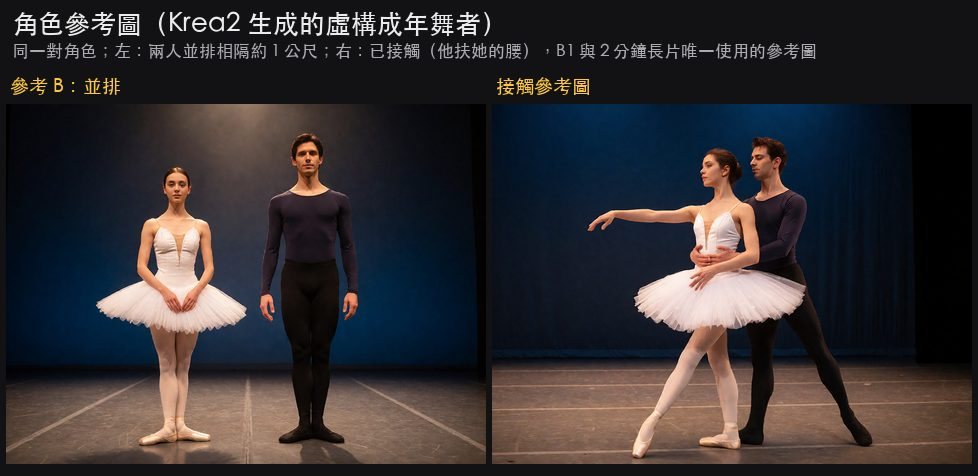
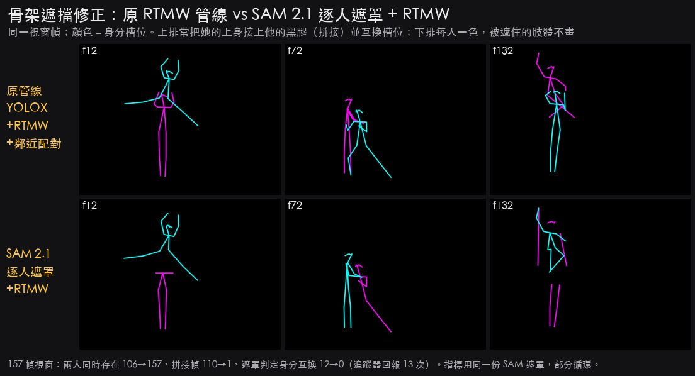
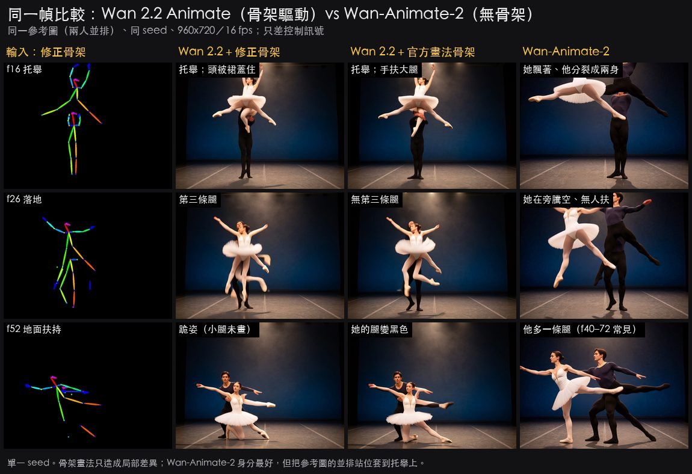
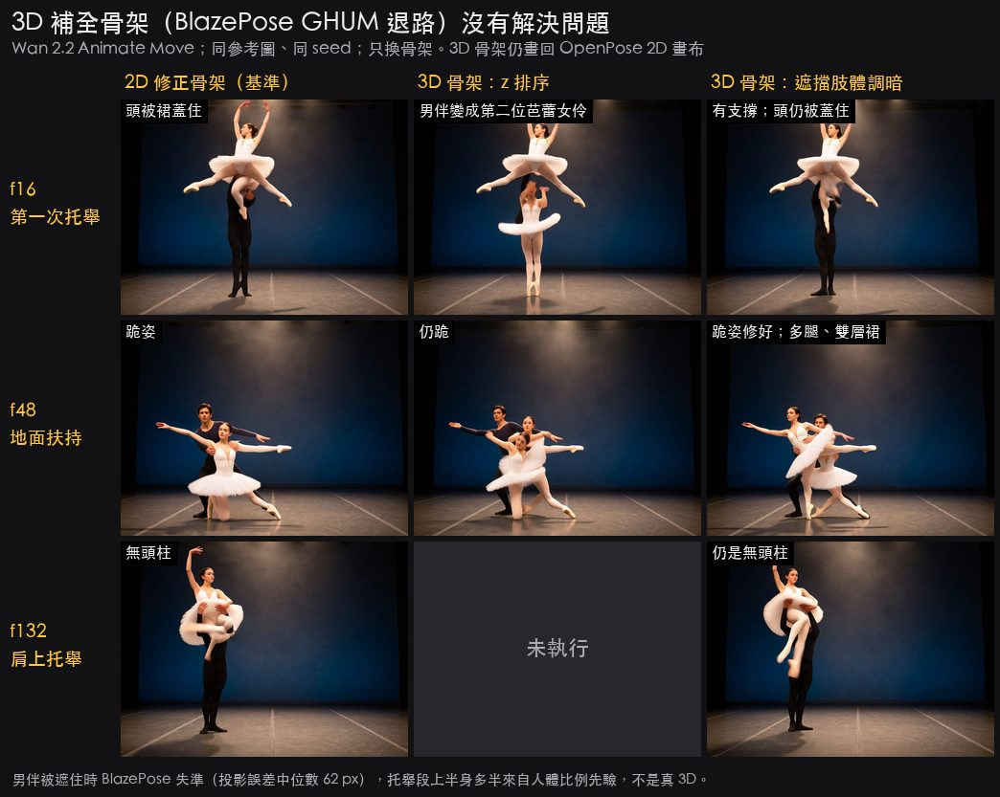
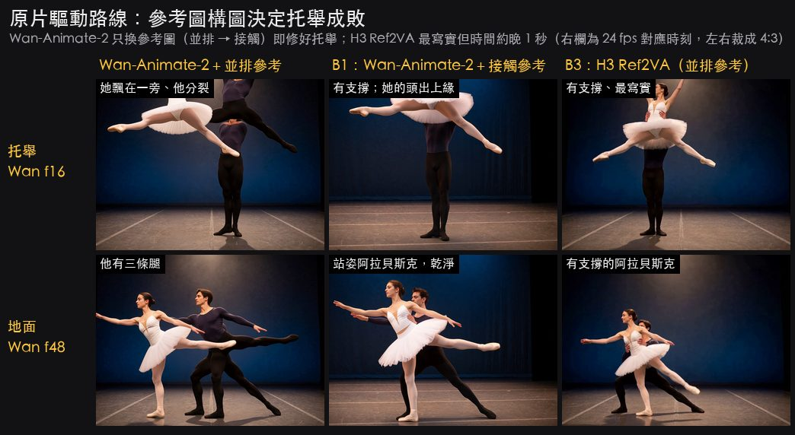
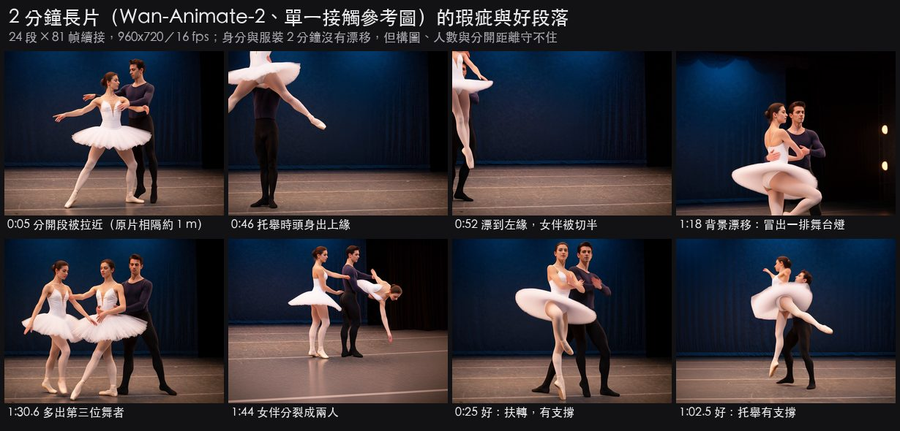

# 多人互動與芭蕾雙人舞：AI 影片生成現況與實測

調研日期：2026-10-11；實測日期：2026-10-10～11。

## 一句話結論

**沒有攻克。** 2026 年 10 月，單人舞蹈已大致可用；多人但不接觸的場景，在有骨架或驅動影片時「可用但不穩」；**貼身接觸、托舉，以及芭蕾特有的技術正確性（足尖、外開、轉圈數）仍是未解問題。**

- 所有獨立 benchmark 的「互動類」分數都明顯低於「單人類」。
- 多人互動資料在主流訓練集中不到 3%（OHBench 論文原文）。
- 2026 年最新的多人動畫論文仍把「遮擋下的身分綁定」列為主要問題，沒有一篇評測托舉。

我們的實測與文獻一致：用 SAM 2.1 逐人遮罩可以修好雙人骨架；骨架驅動的 Wan 2.2 Animate 能做出有支撐的托舉；2 分鐘長片身分與服裝撐得住，但會把分開的兩人拉近、多出人或肢體、托舉時頭部出框。

本文分兩部分：第 1～8 節是文獻與產品調研，第 9 節是我們的實驗。

### 標記

- **[論文]**：一手學術來源。
- **[廠商宣稱]**／**[廠商文件]**：官方行銷、模型卡或使用說明。
- **[二手]**：媒體或部落格評測。
- **[推估]**：未驗證的推論。
- **[我們的測試]**：本文第 9 節的實測。

---

## 1. 已解決 vs 未解決

| 情境 | 狀態 | 依據 |
|---|---|---|
| 單人舞蹈（有驅動影片或骨架） | **大致已解決**（≤ 10–20 秒、中等速度） | Wan-Animate、SCAIL、Kling Motion Control 都以單人為主要場景 [論文／廠商宣稱]；Kling 官方仍建議避免過快動作 [廠商文件] |
| 單人高難度體操或芭蕾（純文字 T2V） | **部分改善，未解決** | MMGR Sports（含 ballet fouetté）：Sora-2 64%、Veo-3 60%、Wan-2.2 21.33% [論文]；VideoPhy-2 運動類最佳只有 31.5% [論文] |
| 多人不接觸（並排、對舞） | **可用但不穩** | OHBench：兩人場景身分扭曲率高於單人 [論文]；單張接觸參考圖會把分開的兩人拉在一起 [我們的測試] |
| 貼身接觸、托舉、扶轉 | **未解決** | MPIE-Bench：網格解剖最高 0.65、互動最高 0.72，但 VLM 評審給 > 0.95 [論文]；MotionWeaver、WeLike2Party 指出基線在遮擋下身分互換、融合或丟人 [論文]；托舉頭部出框、托人者「無頭柱」、第三條腿 [我們的測試] |
| 芭蕾技術正確性（足尖、外開、fouetté 圈數、手位） | **未解決，也沒有專門 benchmark** | MMGR 的 fouetté 例：旋轉中腿與上身扭曲、轉速被生成成慢速 [論文]；HumanScore：「看起來對」與「生物力學對」有系統性落差 [論文] |
| 長片身分與服裝一致性 | **大致可控**（分段＋續接＋剪接點重設參考圖） | 2 分鐘測試無身分或服裝漂移 [我們的測試]；這靠工程手段，不是模型能力 |
| 長片中的空間關係與構圖 | **未解決** | 續接把人物帶到畫面邊緣、背景隨來源鏡頭漂移 [我們的測試] |

---

## 2. Benchmark 證據

### 2.1 通用 benchmark 中與人體或互動相關的維度

| Benchmark | 日期 | 相關維度 | 數字 | 解讀 |
|---|---|---|---|---|
| [VBench-2.0](https://arxiv.org/abs/2503.21755) | 2025-03 | Human Anatomy／Human Interaction | Anatomy：Sora 86.45、Kling 1.6 86.99、Hunyuan 88.58；**Interaction：Sora 58.00、Kling 72.00、Hunyuan 66.67** | 解剖分數用逐幀異常分類器，**抓不到多一條腿、兩人融合這類結構錯誤**；互動維度明顯偏低 |
| [VideoPhy-2](https://arxiv.org/abs/2503.06800)（ICLR 2026） | 2025-03 | 動作導向的物理常識 | 最佳 Wan2.1-14B：整體 32.6%、hard 子集 21.9%；**Sports 31.5% < Object Interaction 36.2%** | 運動與身體活動普遍比物體互動差；最常違反動量與質量守恆 |
| [MMGR](https://arxiv.org/abs/2512.14691)（v3 2026-09-10） | 2025-12 | Physical Commonsense → Sports（25 情境，含 **ballet fouetté**） | **Sora-2 64.0%、Veo-3 60.0%、Wan-2.2 21.33%** | 二元評分；少數明確把芭蕾旋轉列為題目的 benchmark |
| [OHBench／OmniHuman](https://arxiv.org/abs/2604.18326) | 2026-04（v2 2026-05-30） | 兩人 Interaction Naturalness（IN） | Veo3 7.00、LTX-2 6.47、Wan2.5 6.02、Kling2.6 5.50 | 原文：多人互動在現有資料集中「less than 3%」 |
| [HuM-Eval](https://arxiv.org/abs/2604.25361)（ICME 2026） | 2026-04 | 高難度運動、人物互動、人人互動 | Veo3 動作強，但互動任務（HOI／HHI）外觀品質下降 | 互動場景的解剖正確性比單人難 |
| [MPIE-Bench](https://arxiv.org/abs/2607.27616) | 2026-07-30 | 多人互動**圖像編輯**；用 3D 網格重建檢查人形與接觸 | 10 個編輯器：**網格解剖最高 0.65、網格互動最高 0.72**；**VLM checklist 給同一批圖 > 0.95** | **VLM 評審嚴重高估多人接觸品質**，因此我們用目檢逐幀審 |
| [HumanScore](https://arxiv.org/abs/2604.20157) | 2026-04-22 | 13 個模型的生物力學違規 | 失效：時間抖動、解剖不合理姿勢、運動漂移 | 感知合理 ≠ 生物力學正確 |
| [TogetherVideoBench／DanceTogether](https://arxiv.org/abs/2505.18078) | 2025-05 | 雙人舞、拳擊、摔角、花滑 | HOTA 83.94 vs 最佳基線 71.35 | 唯一專為雙人互動「動畫」做的公開 benchmark（SVD 世代） |

### 2.2 體操與芭蕾是已知的失敗類別

- **2024-12**：Sora 生成的體操地板動作爆紅，出現多肢、頭部消失；媒體歸因於訓練資料中體操影片稀少（[Digital Camera World](https://digitalcameraworld.com/tech/software/horrifying-yet-hilarious-viral-gymnastics-video-illustrates-why-videographers-shouldnt-fear-losing-jobs-to-ai-yet)）[二手]。
- **2025-09-30**：OpenAI 宣稱 Sora 2 能生成體操、後空翻、triple axel（[openai.com](https://openai.com/index/sora-2/)）[廠商宣稱]；MMGR 獨立測得 Sports 64% [論文]：大幅改善，但三成多仍至少錯一項。
- **芭蕾雙人舞**：我們**找不到任何針對 pas de deux 或托舉的公開獨立評測**。社群連評測都還沒建立。

---

## 3. 前沿閉源模型：廠商宣稱 vs 獨立證據

| 模型 | 日期 | 廠商宣稱 | 獨立證據 |
|---|---|---|---|
| Sora 2 | 2025-09-30 | 體操、後空翻、triple axel | MMGR Sports 64%（受測最高）[論文] |
| Veo 3／3.1 | 2025-05／2025-10 | 物理與人體動作改善 | MMGR Sports 60%；OHBench 兩人 IN 7.00（受測最高）；HuM-Eval：互動任務外觀下降 [論文] |
| Kling 2.6／3.0（含 Motion Control） | 2025-12／2026-03 | 多角色互動、動作優秀 | OHBench IN 5.50（Kling 2.6，受測最低）[論文]。**官方指南：Motion Control 3.0「only one element is supported」**，多人參考影片只取畫面佔比最大的人（[Kling guide](https://kling.ai/quickstart/motion-control-user-guide)）[廠商文件] |
| Seedance 2.0／2.5 | 2026 | 全面改善（[arXiv 2604.14148](https://arxiv.org/abs/2604.14148)） | 只有二手評測（舞蹈最好；兩人身分分離 3 次成功 2 次）[二手]；無 benchmark 數字 |
| Wan 2.5 → 3.0（閉源 API） | 3.0：2026-08-24 | 30 秒 1080p、多模態參考 | OHBench Wan2.5 IN 6.02 [論文]；開源只到 Wan 2.2 [二手] |
| MiniMax H3 | 2026-07-31 | omni-reference、V2V 動作轉移 | 托舉有支撐、最寫實，但時間落後約 1 秒，不是逐幀複製編舞 [我們的測試] |
| Runway Act-Two | 2025-07 起 | 表演轉移 | **官方說明只支援單角色**，多角色要分開錄再剪（[Runway Help](https://help.runwayml.com/hc/en-us/articles/41748090660499-Creating-Multi-Character-Dialogues-with-Act-Two)）[廠商文件] |

**共同結論**：商業「動作轉移」功能（Kling Motion Control、Runway Act-Two）官方明文只支援單人。沒有任何一家提供「雙人接觸驅動」的產品功能。

---

## 4. 姿態或影片驅動的多人角色動畫研究

| 方法 | 日期 | 底座 | 多人／遮擋怎麼處理 | 報告結果 | 對托舉 | 授權／可用性 |
|---|---|---|---|---|---|---|
| [Wan-Animate-2](https://github.com/Wan-Video/Wan-Animate-2)（[arXiv 2608.06009](https://arxiv.org/abs/2608.06009)） | 2026-08-07 | Wan 2.2 14B | 直接吃驅動影片，不用骨架；宣稱 single-to-multiple | **只有定性結果與使用者研究**，無多人量化數據 [廠商宣稱] | 未提 | Apache-2.0；實測見第 9 節 |
| [SCAIL](https://arxiv.org/abs/2512.05905)（[GitHub](https://github.com/zai-org/SCAIL)） | 2025-12（v3 2026-03） | Wan2.1-14B | **3D 圓柱骨架渲染**（深度與前後順序寫進控制圖）；多人先分割再抽 3D 姿態 | Studio-Bench 動作準確 53.3% vs Wan-Animate 35.0%（人評勝率）[論文] | 自承多人姿態估計精度不如單人 | 程式碼 Apache-2.0；ComfyUI 原生；預設抽取器 NLF 為 **CC BY-NC 4.0（非商用）** |
| [SCAIL-2](https://arxiv.org/abs/2606.10804) | 2026-06-09 | 蒸餾自 SCAIL-Preview 等 | 端到端吃驅動影片 | 宣稱 SOTA [廠商宣稱] | — | MIT |
| [MultiAnimate](https://arxiv.org/abs/2602.21581)（CVPR 2026） | 2026-02 | DiT | 每個角色一個 Identifier | 只用雙人資料訓練，能推到三人以上 [論文] | 未提 | — |
| [MotionWeaver](https://arxiv.org/abs/2602.13326) | 2026-02 | Wan2.1-I2V-14B | 身分無關動作表示 + 共享 4D 空間 | DualDynamics FVD 145.7 vs RealisDance-DiT 164.6；基線在位置互換時身分混淆 [論文] | 未提 | 部分程式碼 |
| [WeLike2Party](https://arxiv.org/abs/2609.36937) | **2026-09-29** | Wan2.1-I2V-14B | 實例遮罩監督身分綁定 | 重疊幀身分綁定 IAAcross **0.9496 vs SCAIL-2 0.8335**；基線含 Wan-Animate-2 [論文] | 列出的基線失效正是我們看到的：身分互換、人物合併或消失、背景複製 | 未釋出 |
| [DanceTogether](https://arxiv.org/abs/2505.18078) | 2025-05 | SVD | 追蹤遮罩 + 姿態熱圖逐人綁定；26 小時雙人花滑 | 見 2.1 | 只到兩人、靜態鏡頭 | 舊世代底座 |
| [Uni3C](https://arxiv.org/abs/2504.14899) | 2025-04 | Wan 系 | 場景點雲 + SMPL-X 放在同一 3D 世界 | 相機與人體控制優於對手 [論文] | 未針對接觸 | SMPL-X 授權限制 |
| [SocialDirector](https://arxiv.org/abs/2605.10079) | 2026-05 | training-free | T2V 的 actor-action mismatch | — | 只處理「誰做什麼」 | — |

**讀法**

- 2026 年主線從 2D 骨架轉向兩條路：**3D-aware 控制**（SCAIL、MotionWeaver、Uni3C）與**直接吃驅動影片**（Wan-Animate-2、SCAIL-2、WeLike2Party）。
- 兩條線都**只處理身分綁定與遮擋排序**，沒有一篇評測托舉或重心支撐。
- WeLike2Party 以 Wan-Animate-2 為基線並報告更好的遮擋綁定：Wan-Animate-2 的多人遮擋問題已被同行量化確認。

---

## 5. 3D 動作生成：雙人互動在 3D 解決了嗎？

| 項目 | 現況 |
|---|---|
| 資料集 | **DD100**（[Duolando, ICLR 2024](https://arxiv.org/abs/2403.18811)）：約 1.9 小時光學動捕、10 種雙人舞，**含 pas de deux**；**MDD**（[2025-08](https://arxiv.org/abs/2508.16911)）：620 分鐘含文字描述 |
| 雙人舞生成 | Duolando → **DuetGen**（[SIGGRAPH 2025](https://arxiv.org/abs/2506.18680)，DD100 SOTA）→ **Contact Matrix**（[2026-05](https://arxiv.org/abs/2605.04662)：FID_k 8.89 vs Duolando 25.30） |
| 物理可行性 | **DIGHT**（[2026-10-07](https://arxiv.org/abs/2610.10322)）：物理模擬追蹤成功率 88.73%、跌倒率 9.32%；**接觸拓撲 precision 只有 38.29%（改進後 46.77%）** |
| 結論 | 3D 雙人互動「比影片好很多，但也沒解決」；DD100 的芭蕾只占 10 種之一，托舉樣本應該很少 [推估] |
| 能否當影片控制？ | 3D 有明確的人物歸屬、深度順序與骨長，正是 2D 骨架缺的。但我們實測（9.4 節）把 3D 補全的骨架畫回 OpenPose 2D 再餵 Wan 2.2，**會長出第二位芭蕾舞者**。控制訊號本身必須是 3D-aware（深度、圓柱骨架或逐人遮罩），不能投影成 2D 線條 |

---

## 6. 文獻中歸納的根因

1. **資料稀缺**：多人互動不到 3%（OHBench）；Wan-Animate 的訓練資料刻意篩成單角色；體操與芭蕾畫面稀少。
2. **身分綁定**：多人時 token 不知道對應哪個參考身分（MultiAnimate、WeLike2Party、SocialDirector 都在處理），於是出現互換、融合、第三人。
3. **2D 姿態歧義、缺深度**：OpenPose 畫布依肢段上色而不是依人上色，也沒有前後順序；SCAIL 自承多人姿態估計是瓶頸。
4. **沒有物理與重心概念**：VideoPhy-2 指出動量與質量守恆最常被違反；托舉要求下方的人承重，純外觀模型學不到 [推估]。
5. **評測盲點**：逐幀異常分類器與 VLM 評審都抓不到多肢或融合（MPIE-Bench、HumanScore），廠商宣稱因此與實際品質脫鉤。
6. **長度與續接**：81 幀分段、只接 1 幀，空間佈局沿用上一段（我們的邊緣漂移）。

---

## 7. 最有希望的研究方向

1. **3D-aware 控制取代 2D 骨架**：SCAIL（Apache-2.0、ComfyUI 原生、Wan 14B）的圓柱骨架帶深度順序。社群已有 Blender rig → SCAIL pose 節點，可直接吃 3D 預演的關節，繞過非商用的 NLF。這是對「托人者無頭柱、肢體歸屬錯」最對症的一條 [推估]。
2. **逐人身分綁定**：WeLike2Party（遮罩監督）與 MultiAnimate（Identifier）有效但未釋出；釋出後值得與 Wan-Animate-2 對比 [推估]。
3. **3D 雙人舞先驗**：DD100 + DuetGen／Contact Matrix 補舞伴，DIGHT 類物理追蹤驗證托舉能否承重，只用於編舞或預演 [推估]。

---

## 8. 建議管線

### P1（接觸與托舉最可靠，未驗證）：3D 預演 → 3D-aware 控制 → 生成 → 局部修補

1. 在 3D 預演工具中把托舉擺對（重心、手位），**構圖預留頭頂空間**，直接處理「托舉頭部出框」。
2. 輸出逐人控制：SCAIL 圓柱骨架；或逐人 2D 骨架（各自上色）+ 深度圖 + 逐人遮罩。
3. 生成：首選 SCAIL；備選 Wan 2.2 Animate Move + 逐人骨架（已證實托舉優於無骨架的 Wan-Animate-2，見 9.3）。
4. SAM 2.1 逐人遮罩做 QA 與局部重繪（只重跑多出肢體的區段）。
5. 第一個該跑的 A/B：同一段托舉，SCAIL 圓柱骨架 vs Wan 2.2 逐人骨架。

### P2（真人素材驅動，快速）：Wan-Animate-2 + 分段參考圖 + 構圖控制

2 分鐘實測已證明可產出、身分穩定（9.6）。要修三點：

- **依段落換參考圖**：分開段用「兩人分開」的參考圖，接觸段用接觸參考圖。
- **參考圖人物縮小、留頭頂空間**，處理托舉出框。
- **限制每段長度**（≤ 20 秒或在換場處重設），逆光剪影段特別 QA。

### P3（寫實短鏡頭）：H3 Ref2VA 以影片當參考

適合 ≤ 5–10 秒的關鍵托舉：最寫實、無洩漏，但時間不準。用在「好看比對拍重要」的鏡頭。

### 不建議

- 純 T2V 生成整段雙人芭蕾。
- 把 3D 補全的關節投影成 OpenPose 2D 再餵 Wan（9.4）。
- Wan 2.2 Animate Replace 的聯集遮罩模式（9.5）。
- 商業 Motion Control 或 Act-Two 直接吃雙人影片：官方明文只取一人。

---

## 9. 我們的實驗

所有生成在一張 RTX 5090（32 GB）上以 ComfyUI 執行。驅動素材是 Pexels 上 MART PRODUCTION 的芭蕾雙人舞片段（見文末授權）。**本文圖片不含任何來源影片畫面**，只有生成結果、骨架渲染與虛構角色參考圖。每個條件只跑一次（Wan 系列固定 seed 202610100201），每一幀都經人工目檢；結論不能當成統計結果。

### 9.1 角色參考圖

兩張參考圖都由 Krea2 生成，是虛構的成年舞者。**參考 B**（兩人並排、相隔約 1 公尺）用於 9.3 與第一次 Wan-Animate-2；**接觸參考圖**（他扶她的腰）用於 B1 與 2 分鐘長片。

### 9.2 雙人骨架遮擋修正

**根因在框內，換偵測器或調 NMS 都修不好。** 男舞者站在女舞者正後方或在托舉中位於她下方時，偵測器要嘛漏掉被遮的人，要嘛畫一個包住兩人的框。RTMW 每個關節各自取最強響應，拼出「她的上身 + 他的黑腿」；而依鄰近距離配對的追蹤沒有外觀線索，空檔後槽位就會互換。

**有效的修正：SAM 2.1 影片遮罩，再對每個人分別跑 RTMW**（估姿態時把對方塗成背景；遮罩的 object id 就是身分）。157 幀視窗（全片 233 幀）：

| 方法 | 兩人同時存在 | 兩副骨架屬於不同人 | 拼接幀 | 身分互換（遮罩判定） | GPU 時間 |
|---|---:|---:|---:|---:|---|
| 原管線（HumanArt YOLOX-m s>0.3 + RTMW + 鄰近配對） | 106 / 157 | 27 | **110** | 12（追蹤器回報 13） | 偵測 2.4 s + 姿態約 6 s |
| DWPose YOLOX-L，可調 NMS 0.45–0.8 | 33–87 | 13–23 | 91–104 | 18–28 | — |
| RTMO-l／RF-DETR-L 偵測框 | 114–138 | 39–48 | 109–113 | 20–27 | 約 5–6 s／次 |
| 外觀 Viterbi 追蹤 + 補幀 | 89–125 | 23–33 | 77–94 | 8–17 | + 0.5 s CPU |
| **SAM 2.1 + RTMW（採用版）** | **157 / 157** | **154** | **1** | **0** | SAM 20.5 s + RTMW 21 s |

- 調 NMS、換偵測器只增加兩骨架幀數，不減少拼接；追蹤只能減少互換，不能拆開已拼接的骨架。
- **注意：拼接與身分互換的判定用的就是同一份 SAM 遮罩**，對 SAM 方法而言部分是循環論證。遮罩已人工逐幀審過 233 幀；另一個不依賴 SAM 的亮度檢查（看小腿是淺色褲襪還是黑褲襪）在托舉時會誤報。
- 刻意**不畫被遮住的肢體**：男舞者完全在她身後時只畫得出小腿或什麼都沒有。這在 9.3 會帶來副作用。
- SAM 2.1-L 傳播時裝置記憶體推到 31.1 / 32.6 GB（另一個模型常駐時）；部署時要加 GPU 鎖或把 inference state 放 CPU。

### 9.3 Wan 2.2 Animate + 修正骨架 vs 官方畫法骨架 vs Wan-Animate-2

設定：960x720、16 fps、81 幀（Wan 2.2 另續接 76 幀共 157 幀）、同參考 B、同 seed。Wan 2.2 Animate 14B fp8 + Lightx2v 6 步；Wan-Animate-2 為蒸餾 int8、10 步。

| 項目 | Wan 2.2 + 修正骨架 | Wan 2.2 + 官方畫法骨架 | Wan-Animate-2（無骨架） |
|---|---|---|---|
| 身分／服裝 | 穩定、無互換 | 穩定、無互換 | 極好、無互換 |
| 間距與遮擋深度 | 跟原片（他在她身後或下方） | 同左 | 套用參考圖的並排站位 |
| 第一次托舉 f10–28 | **有支撐**；他的頭被裙蓋住 | **有支撐**；他的手扶她大腿 | **失敗**：她在旁騰空、他分裂成兩個身體 |
| 多餘肢體 | 第三條腿 f26–28 | 她的抬腿變成黑褲襪 f50–56 | 多一個頭 f0–2、他三條腿 f40–72、第二個身體 f58–70 |
| 刻意未畫的男伴 | 不消失，Wan 讓他留在她身後 | 同左 | 不適用 |
| 姿勢忠實度 | f36–66 **跪下**（她的小腿沒畫） | 同左 | 站姿阿拉貝斯克（較接近原片） |
| 構圖 | 全身入鏡 | 同左 | 托舉時她的頭出上緣 |
| 執行時間／VRAM 峰值（81 幀） | 237 s（含冷載入）／26.8 GB | 180 s／26.0 GB | 400 s／25.9 GB |

- 對貼身扶持，**明確的逐人骨架勝過不用骨架的影片驅動**：骨架帶有深度與支撐關係，Wan-Animate-2 丟掉了它們。
- **沒畫的關節不是中性的**：被遮住的舞伴處理得很好，但被遮住的小腿變成另一個姿勢（跪姿）。
- 骨架畫法（rtmlib 風格 vs 官方 `draw_aapose_new`）只是次要因素；單一 seed，兩者不分勝負。
- 第二段續接（f81 接縫）看不出跳動：接縫幀差 4.5，中位數 3.6。肩上托舉 f114–156 有支撐，但他的頭和肩一直沒出現，像「無頭柱」。

### 9.4 3D 骨架路線（BlazePose GHUM 退路）：失敗

- 首選的 SAM 3D Body 是 Hugging Face 閘門模型（SAM License，需人工同意），未取得授權，沒有下載或使用鏡像。其他 3D 估計器多為非商用或 SMPL 授權。
- 退路：**MediaPipe Pose Landmarker heavy（BlazePose GHUM 3D，Apache-2.0）**，逐人估計（用 SAM 遮罩把對方塗掉）。
- 投影誤差（157 幀視窗、只算 RTMW 可見關節）：女舞者中位數 7.9 px（對齊後平均 14.5 px，可用）；**男舞者中位數 62 px**（對齊後 38 px），他被她遮住頭與軀幹時 BlazePose 就失準，而這正是需要補的時候。男舞者上半身只有 27 幀來自 BlazePose，114 幀來自人體比例先驗。**所以「3D」只對她的小腿與前後順序成立，托舉中他的骨架其實是 2D 先驗。**
- 畫成兩種 OpenPose 風格骨架餵 Wan 2.2：
  - **z 排序**：第一次托舉時**男舞者變成第二位芭蕾女伶**（白紗裙、粉色褲襪），仍跪。
  - **遮擋肢體調暗 45%**：跪姿修好了，但多一條腿、紗裙變雙層（f40–56）；肩上托舉他仍然沒有頭。
- 教訓：補畫被遮住的關節不是中性的。畫出被遮住的頭，模型也不會因此把頭畫出來。

### 9.5 原片驅動路線 B1／B2／B3

| 路線 | 做法 | 結果 | 時間／VRAM |
|---|---|---|---|
| **B1** | Wan-Animate-2，**只把參考圖換成接觸參考圖**，其餘同設定、同 seed | **最佳**：托舉有支撐（他在下方、手扶腰、腳踩穩），無分裂、無漂浮、無多頭或第三條腿，地面段站姿不跪。剩下：托舉時她的頭出上緣（f16–28）、他的頭被裙蓋住、f0–2 她的臉短暫變形。無來源洩漏 | 404 s／25.7 GB |
| B2 | Wan 2.2 Animate Replace，兩人聯集遮罩一次跑 | **不可用**：黑色填補留下黑塊、乾淨背景填補讓舞者變幽靈、緊遮罩變黑色剪影；且來源背景與服裝會被保留（設計如此） | 186–243 s／26.0–26.8 GB |
| B3 | H3 Ref2VA，以 5 秒原片當影片參考（參考 B），1344x768、24 fps、20 步 | 托舉有支撐、**最寫實**、身分穩定、無洩漏；但開頭在參考圖的並排站姿停約 1 秒，**托舉比原片晚約 1 秒**，不是逐幀複製 | 812 s／30.6 GB |

所謂「接觸參考圖」，是指參考圖本身已經呈現兩人接觸的構圖。Wan-Animate-2 會把參考圖的站位當成版面先驗：參考是並排，托舉就被拆成兩個人；參考已接觸，托舉就能成立。**失敗的原因是參考圖構圖，不是模型本身。** B2 的輸出含來源背景，因此不放圖。

### 9.6 2 分鐘長片：Wan-Animate-2 + 單一接觸參考圖

設定：8 支同一場拍攝的 Pexels 片段接成 1928 幀（120.5 秒），960x720、16 fps、24 段 × 81 幀，蒸餾 int8、10 步、同 seed、整部只用一張接觸參考圖。

- **續接機制**：Wan-Animate-2 的 `continue_motion` 只沿用前一段最後 1 幀；第一段 81 幀、之後每段新增 80 幀。原生 loop 尚未合併，官方模板靠手動複製子圖。我們每段一個 prompt，以便先檢查再送下一段。來源剪接處開新鏈。
- **接縫看不出來**：16 個續接點的幀差 1.3–6.4，都不高於鄰近幀中位數（1.7–13.1）。
- **身分與服裝 2 分鐘內沒有累積漂移**、兩人沒有互換、臉沒有變形。最長一條鏈 4 段（20 秒），每個剪接點都從參考圖重新開始。
- 成本：每段 398–409 s（合計 9620 s = 2 小時 40 分）、VRAM 峰值 23.4–25.9 GB，無 OOM 或重試。SeedVR2 7B 放大到 1920x1440 另花 4180 s（峰值 27.1–30.8 GB）；放大修不好任何生成瑕疵，反而在 3 個分段交界產生銳利度跳動。

瑕疵時間軸（節錄）：

| 時間 | 類型 | 說明 |
|---|---|---|
| 0:00–0:08 | 分開段被拉近 | 原片並肩相隔約 1 m；輸出維持參考圖的貼身站位，而且左右對調 |
| 0:11.5–0:14 | 肢體／角色互換 | 她的阿拉貝斯克腿畫成他的黑腿 |
| 0:15–0:20 | 舞伴被藏住 | 他整段疊在她正後方 |
| 0:45.3–0:47 | 托舉出框 | 她的頭身、他的頭超出上緣（托舉本身有支撐） |
| 0:48–0:55.2 | 出框（最嚴重） | 兩人漂到左緣、她被切半；續接把位置一路帶到下一個剪接點 |
| 0:57.5–0:58、1:01.5–1:02、1:07.8–1:10 | 背景漂移 | 來源鏡頭移動被轉移，地平線跳 35–110 px |
| 1:16.5–1:20.3 | 背景漂移 | 布幕右半變黑，冒出一排圓形舞台燈 |
| 1:21.5–1:23 | 分開段被拉近 | 原片手牽手相隔一臂；輸出他仍貼在她身後 |
| 1:30.4–1:31 | 多出一人 | 第二位一模一樣的女舞者出現後合併 |
| 1:31.6、1:34.4 | 多餘肢體 | 一件紗裙下四條腿；頭後多一個髮髻 |
| 1:42.4–1:45.4 | 多出一人 | 她分裂成兩人，最後融成一件紗裙、兩個頭 |
| 1:55.5–1:57.8 | 出框（來源造成） | 來源鏡頭下搖到腿部，輸出只剩腿 |

做得好的段落：0:20–0:40（扶轉、托腰、développé、promenade、penché）、1:01–1:03 與 1:08–1:10 的托舉、1:45–1:55（來源低角度、腳被切，輸出仍是乾淨的全身）。

**一張接觸參考圖撐得住身分，撐不住分開。** 明亮、全身入鏡的段落裡，來源明顯分開時，輸出仍維持參考圖的貼身構圖；唯一保留分開的是逆光剪影那條鏈（1:31–1:40），代價是身分複製（第三人、雙頭、四條腿）。另一個只有長片才看得到的問題：**版面漂移會被續接繼承**，直到剪接點才恢復。

下一步（未驗證）：分開段改用「兩人分開」的參考圖並在剪接點換圖；人物小、托舉高的素材改用人物較小、頭頂留白較多的參考圖；避開或預處理逆光素材；鏡頭移動多的素材先穩定化。

### 9.7 我們的證據與文獻對照

| 我們觀察到 | 文獻對應 |
|---|---|
| 單張接觸參考圖讓分開的兩人被拉近 | WeLike2Party：基線出現背景複製、參考或驅動外觀洩漏 |
| 逆光段多出一位舞者、四條腿、兩個頭 | MPIE-Bench 的多出肢體與肢體融合；MotionWeaver 的遮擋失效 |
| 托人者的頭被藏住，成為「無頭柱」 | SCAIL：多人姿態估計在遮擋下仍是瓶頸 |
| 托舉頭部出框、邊緣漂移 | 文獻少有討論，屬構圖與續接的工程問題 |
| 身分與服裝撐過 2 分鐘 | 與 Wan-Animate-2、SCAIL 的身分保持宣稱一致；但我們靠剪接點重設 |

---

## 10. 可信度與限制

- 部分論文數字取自論文 HTML 或摘要，經自動摘要工具讀取，**未逐表人工核對原 PDF**。
- Seedance 與 Kling「舞蹈最強」屬二手評測；有二手來源稱 Veo 3 的 VBench-2.0 Anatomy 為 86.88，未核實，因此不列入表格。
- 廠商宣稱與獨立證據已分欄；多數閉源模型沒有雙人接觸的公開量化數據。
- 我們的實測：單一 seed、單一來源視窗（長片為 8 支同場片段）、單一評審非盲目檢；骨架指標部分循環（見 9.2）。H3 只跑 5 秒、B1 未跑續接段與肩上托舉。
- 本文不是統計比較，只說明各路線在這組素材上的失效模式。

## 授權與素材

- **驅動動作來源**：MART PRODUCTION via Pexels（[Pexels License](https://www.pexels.com/license/)，可修改、不需署名，仍註明）。片段 ID：
  [8462478](https://www.pexels.com/video/a-couple-of-dancers-training-at-a-ballet-studio-8462478/)（9.2–9.5 的骨架與驅動）、
  [8462487](https://www.pexels.com/video/man-and-woman-dancing-ballet-8462487/)、
  [8462227](https://www.pexels.com/video/a-ballerina-and-a-danseur-during-a-rehearsal-8462227/)、
  [8462505](https://www.pexels.com/video/people-doing-ballet-dancing-8462505/)、
  [8462455](https://www.pexels.com/video/people-doing-ballet-dancing-8462455/)、
  [8462514](https://www.pexels.com/video/people-doing-ballet-dancing-8462514/)、
  [8462220](https://www.pexels.com/video/ballet-dancers-performing-together-8462220/)、
  [8462344](https://www.pexels.com/video/ballet-dancers-dancing-together-at-rehearsal-8462344/)（9.6 長片）。
  來源畫面只作為骨架抽取或 `pose_video` 驅動輸入，**本文不含任何來源畫面**。
- **角色**：Krea2 生成的虛構成年舞者；所有影片中的人物、服裝與舞台都來自參考圖。
- **模型授權**（使用前請再查各模型卡）：Wan 2.2 Animate、Wan-Animate-2 為 Apache-2.0；SAM 2.1、RTMO、RF-DETR、MediaPipe BlazePose GHUM 為 Apache-2.0；SCAIL 程式碼 Apache-2.0，但預設抽取器 NLF 為 CC BY-NC 4.0；SAM 3D Body 為 SAM License（閘門，未使用）。Krea2、MiniMax H3、SeedVR2 的授權本文未核實。

## 相關筆記

- [DreamID-V 影片換臉：人臉偵測裁切與整張畫面的對照](../dreamid-v-face-swap-ab/README.md)：同一張 RTX 5090、Wan 系影片模型的單人換臉實驗。
- [多角色參考圖生成比較：Codex／Qwen Edit／H3](../h3-codex-qwen-multi-character-reference-comparison/README.md)：靜態圖像的多角色綁定與接觸動作。
- [Wan 2.2 架構筆記](../../domains/computer_vision/wan/README.zh-TW.md)、[Segment Anything](../../domains/computer_vision/Segment_Anything/README.zh-TW.md)。
